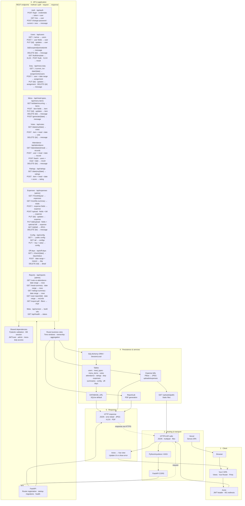

# SR Mess Management Architecture

### Conventions

- Protected routes require a valid JWT. Admin and mess-duty access are enforced by backend dependencies.
- JSON bodies are validated by Pydantic; response shapes are shown after `→`. Uploads and downloads use multipart or binary responses.
- API errors use HTTP status codes and, where provided, a JSON `detail`. The frontend redirects to login on `401`.
- Database and upload locations are deployment-configured; `DATABASE_URL` defaults to SQLite.
